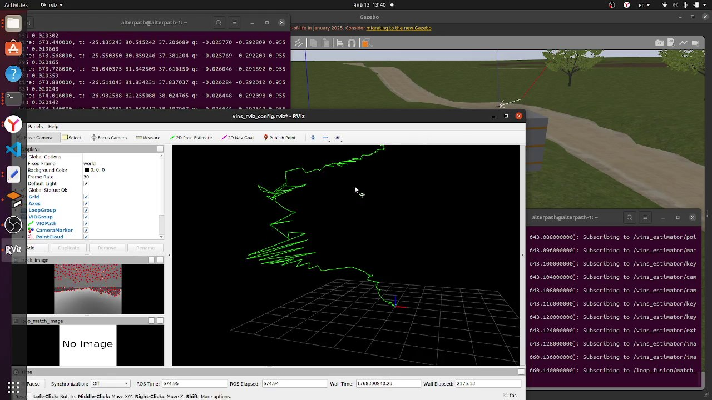

# VINS-Fusion in Gazebo: Visual-Inertial Navigation of a Clover Quadcopter

[Русская версия](README.md)

December 2025 – January 2026. Testing VINS-Fusion as a position source for a Clover quadcopter in the Gazebo simulator (PX4 SITL, MAVROS):
- `vins_estimator` estimates the pose from the camera and the IMU;
- `vpe_publisher` passes it to PX4 as an external position estimate (`/mavros/vision_pose/pose`);
- the drone flies a route through `simple_offboard` and `vins_path_follower`.

This repository holds my control scripts for these experiments and the flight recordings.

## Scripts

| File | What it does |
|---|---|
| `scripts/vins_fusion_controller2.py` | The first controller: arms the drone, switches to OFFBOARD and sends position setpoints to `/mavros/setpoint_position/local`, checking them against the VINS odometry |
| `scripts/vins_fusion_controller.py` | VINS initialization: small velocity moves through `/mavros/setpoint_velocity/cmd_vel` so that the estimate can start |
| `scripts/imu_pid_flight_test.py` | A flight with my own PID controllers: roll and pitch stabilization from the IMU and position correction in x, y and z. Commands go through the Clover `navigate` service |
| `scripts/vins_simple_controller.py` | Takeoff and a waypoint flight through `navigate`, subscribed to the VINS estimate |
| `scripts/relay.py` | Passes the VINS odometry to PX4 as an external position estimate (`/mavros/vision_pose/pose`) |
| `scripts/odom_transform.py` | Converts the VINS odometry into the drone frame and publishes `/vins_estimator/corrected_odometry` and `/vins_estimator/corrected_pose` |
| `scripts/timed_flight.py` | A timed flight: OFFBOARD setpoints from the VINS odometry with MAVROS state checks |
| `scripts/flight.py` | A waypoint mission through `navigate` at 0.1 m/s |
| `launch/start.launch` | Starts `vins_estimator` with the camera config, a static `world → vins_world` TF and `odom_transform.py`. The package name for `odom_transform.py` has to be set to your workspace |
| `config/cam0_pinhole_clover.yaml` | The Clover camera model in Gazebo: 640 × 480, fx = fy = 184.75 |

## Recordings

The bag files are 1–1.4 GB each and do not fit into git, so they are in the repository [release](../../releases). All of them were recorded on January 13, 2026.

| File | Time | Duration | Contents |
|---|---|---|---|
| `plains_simple_flight_VINS_didnot_start.bag`, 1.28 GB | 12:55 | 114 s | A simple flight in the plains world. VINS did not initialize: the recording has feature tracks and a point cloud but no odometry |
| `plains_simple_flight_VINS_started.bag`, 0.98 GB | 13:39 | 77 s | The same world, VINS started: odometry, path, keyframes, point clouds |
| `plains_simple_flight_VINS_started.mkv`, 10 MB | 13:40 | 1 min 49 s | A screen recording of that flight: RViz, Gazebo and logs |
| `2026-01-13-14-01-30.bag`, 1.35 GB | 14:01 | 60 s | The warehouse world, a flight with a program written for VINS. The full Clover topic set: camera, optical flow, rangefinder, MAVROS, VINS and path following |

Durations are in simulation time.

## What it shows

<p align="center"></p>

- **In RViz** the green line is the path estimated by VINS, on the left are the feature tracks on the camera frame, and Gazebo runs behind the RViz window.
- **The estimate drifts.** The path zigzags, and in under a minute the position estimate moves tens of meters away: the log shows about (−25, 80, 37) m while the drone flies a simple route over a field.
- **Why these recordings matter.** They are for analyzing such failures: the bag files contain camera frames, IMU, VINS estimates and the setpoints PX4 received.

<p align="center"><br>The start of the same flight</p>

## Quick start

You need ROS Noetic, the Clover simulator and VINS-Fusion in one catkin workspace.

```bash
roslaunch clover_simulation simulator.launch
rosrun vins vins_node <VINS config for the Clover camera>.yaml
python3 scripts/relay.py      # the VINS estimate goes to PX4
python3 scripts/flight.py     # waypoint flight
roslaunch vins vins_rviz.launch
```

To view a recording:

```bash
rosbag info plains_simple_flight_VINS_started.bag
roscore &
rosbag play --clock plains_simple_flight_VINS_started.bag
rviz   # /vins_estimator/path, /vins_estimator/odometry, /vins_estimator/image_track
```

## Tech stack

ROS Noetic, Python (rospy), Gazebo, PX4 SITL, MAVROS, Clover (COEX), VINS-Fusion, RViz.

## License

[MIT](LICENSE)

---

<sub>The code was written from December 2025 to January 2026 and published on GitHub in November 2026. Commit dates follow the dates of the original files; the README and figures were added at publication.</sub>
