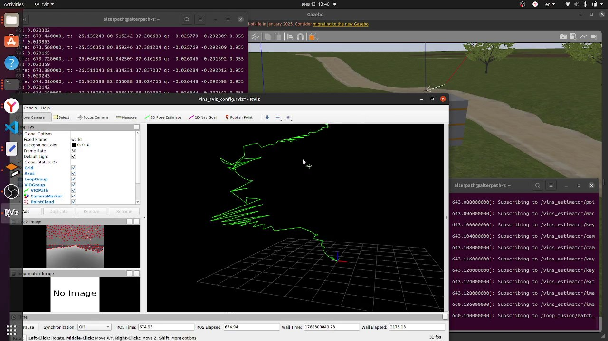

# VINS-Fusion в Gazebo: визуально-инерциальная навигация квадрокоптера Clover

[English version](README.en.md)

Декабрь 2025 – январь 2026. Проверка VINS-Fusion как источника позиции для квадрокоптера Clover в симуляторе Gazebo (PX4 SITL, MAVROS):
- `vins_estimator` оценивает позу по камере и IMU;
- `vpe_publisher` передаёт её в PX4 как внешнюю оценку позиции (`/mavros/vision_pose/pose`);
- дрон летит по маршруту через `simple_offboard` и `vins_path_follower`.

Здесь мои скрипты управления для этих экспериментов и записи полётов.

## Скрипты

| Файл | Что делает |
|---|---|
| `scripts/vins_fusion_controller2.py` | Первый контроллер: взводит дрон, включает OFFBOARD и шлёт уставки позиции в `/mavros/setpoint_position/local`, сверяясь с одометрией VINS |
| `scripts/vins_fusion_controller.py` | Инициализация VINS: небольшие движения по скорости через `/mavros/setpoint_velocity/cmd_vel`, чтобы оценка стартовала |
| `scripts/imu_pid_flight_test.py` | Полёт со своими ПИД-регуляторами: стабилизация крена и тангажа по IMU и коррекция позиции по x, y, z. Команды идут через сервис Clover `navigate` |
| `scripts/vins_simple_controller.py` | Взлёт и облёт точек через `navigate` с подпиской на оценку VINS |
| `scripts/relay.py` | Передаёт одометрию VINS в PX4 как внешнюю оценку позиции (`/mavros/vision_pose/pose`) |
| `scripts/odom_transform.py` | Переводит одометрию VINS в систему координат дрона и публикует `/vins_estimator/corrected_odometry` и `/vins_estimator/corrected_pose` |
| `scripts/timed_flight.py` | Полёт по времени: уставки OFFBOARD по одометрии VINS с проверкой состояния MAVROS |
| `scripts/flight.py` | Миссия по точкам через `navigate` на скорости 0,1 м/с |
| `launch/start.launch` | Запускает `vins_estimator` с конфигом камеры, статический TF `world → vins_world` и `odom_transform.py`. Имя пакета для `odom_transform.py` нужно поправить под свой workspace |
| `config/cam0_pinhole_clover.yaml` | Модель камеры Clover в Gazebo: 640 × 480, fx = fy = 184,75 |

## Записи

Bag-файлы весят 1–1,4 ГБ и в git не помещаются, поэтому лежат в [релизе](../../releases) репозитория. Все записаны 13.01.2026.

| Файл | Время | Длительность | Что внутри |
|---|---|---|---|
| `plains_simple_flight_VINS_didnot_start.bag`, 1,28 ГБ | 12:55 | 114 с | Простой полёт в мире plains. VINS не инициализировался: в записи есть трек признаков и облако точек, одометрии нет |
| `plains_simple_flight_VINS_started.bag`, 0,98 ГБ | 13:39 | 77 с | Тот же мир, VINS запустился: одометрия, путь, ключевые кадры, облака точек |
| `plains_simple_flight_VINS_started.mkv`, 10 МБ | 13:40 | 1 мин 49 с | Запись экрана этого полёта: RViz, Gazebo и логи |
| `2026-01-13-14-01-30.bag`, 1,35 ГБ | 14:01 | 60 с | Мир warehouse, полёт по программе, написанной под VINS. Полный набор топиков Clover: камера, оптический поток, дальномер, MAVROS, VINS и следование по пути |

Длительность указана во времени симуляции.

## Что видно

<p align="center"></p>

- **В RViz** зелёным показан путь по оценке VINS, слева трек признаков на кадре камеры, за окном RViz работает Gazebo.
- **Оценка дрейфует.** Путь уходит зигзагом, и меньше чем за минуту оценка позиции уезжает на десятки метров: в логе около (−25; 80; 37) м, хотя дрон летит простой маршрут над полем.
- **Зачем эти записи.** Они нужны, чтобы разбирать такие срывы: в bag-файлах есть кадры камеры, IMU, оценки VINS и уставки, которые получал PX4.

<p align="center"><br>Начало того же полёта</p>

## Запуск

Нужны ROS Noetic, симулятор Clover и VINS-Fusion в одном catkin workspace.

```bash
roslaunch clover_simulation simulator.launch
rosrun vins vins_node <конфиг VINS под камеру Clover>.yaml
python3 scripts/relay.py      # оценка VINS уходит в PX4
python3 scripts/flight.py     # полёт по точкам
roslaunch vins vins_rviz.launch
```

Посмотреть запись:

```bash
rosbag info plains_simple_flight_VINS_started.bag
roscore &
rosbag play --clock plains_simple_flight_VINS_started.bag
rviz   # /vins_estimator/path, /vins_estimator/odometry, /vins_estimator/image_track
```

## Стек

ROS Noetic, Python (rospy), Gazebo, PX4 SITL, MAVROS, Clover (COEX), VINS-Fusion, RViz.

## Лицензия

[MIT](LICENSE)
